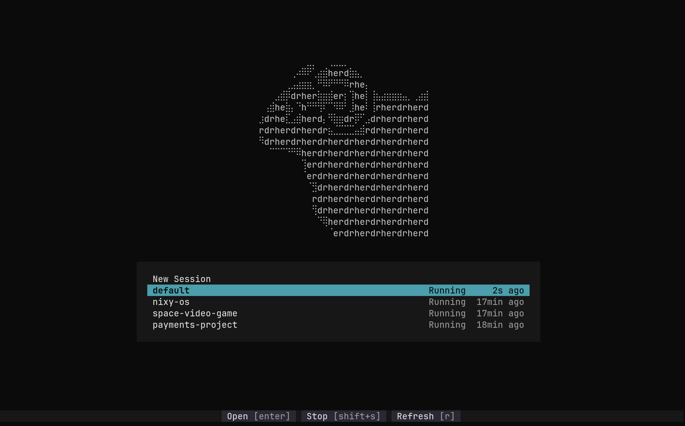

<p align="center">
  
</p>

<h1 align="center">Herdr Select</h1>

<p align="center">A tui selector for herdr and herdr-core sessions.</p>

<p align="center">
  <a href="#how-it-works">How it works</a> ·
  <a href="#choosing-herdr-or-herdr-core">Choosing herdr or herdr-core</a> ·
  <a href="#installation">Installation</a> ·
  <a href="docs/nix.md">Nix setup</a> ·
  <a href="LICENSE">MIT license</a>
</p>

I like to group my [Herdr](https://github.com/herdrdev/herdr) tabs/agents by project and herdr sessions are the best way to do that.

`herdr-select` is a simple utility program written in Go which interacts with your local `herdr` cli, or with herdr-core (`hc`),
to easily see all your sessions at once, create a new one or stop/delete them.

Specifically, I use this with nixy-os as a hotkey with super+shift+return to launch herdr by first starting herdr-select
to show me which project setup I want to jump into (aka session), and go from there.


## How it works

Herdr Select speaks one of two session protocols, and looks the same in both:

- **herdr (v1).** Herdr Select calls your installed `herdr` CLI. Herdr manages the actual sessions, processes, persistence, and restoration.
- **herdr-core (v2).** Herdr Select reads herdr-core's state and runtime folders itself and launches a herdr-core client, such as `herdr-app` or `rodeo`, on the chosen session. It uses `hc` only to stop a session.

What you get in both:

- **Pick up where you work.** Existing sessions sort from newest to oldest, with Running/Stopped status and compact ages such as `5min ago`.
- **Default at your fingertips.** The `default` session is highlighted on startup wherever it falls in the list.
- **Start something new.** New Session stays at the top. Enter a name, choose OK, and the client opens it.
- **See the actions that apply.** The centered footer changes with your selection: Open and Stop for a running session, Resume for a stopped one, and Delete where supported.
- **Confirm before stopping or deleting.** Deleting a running session stops it first, after confirmation. The `default` session cannot be deleted.

If a session's state cannot be determined, its row shows **Unavailable** with a diagnostic; stop/delete stay disabled until a successful refresh. Failed refreshes keep the last list visible as stale. Yellow action notices disappear after three seconds; red errors remain until resolved, dismissed, or replaced by a later action result.

The age indicates saved-state recency, not every keystroke or agent action. For herdr it comes from the modification time of each session's `session.json`; for herdr-core, from the newest file directly inside the session's state folder (such as `core.json` or `terminals.json`). Missing timestamps display `—` and sort last. Ages stay fixed until the list is loaded again: press `r` to refresh, or complete a session operation that reloads the list.

Herdr Select refuses to run inside an existing session: from a herdr pane (`HERDR_PANE_ID`) or an hc terminal (`HC_TERMINAL_ID`), which includes every pane in rodeo and herdr-app. Detach first, then run it again.

## Choosing herdr or herdr-core

```sh
herdr-select                    # pick by what is installed
herdr-select --app=herdr        # herdr (v1)
herdr-select --app=herdr-app    # herdr-core (v2), opened in herdr-app
herdr-select --app=rodeo        # herdr-core (v2), opened in rodeo
herdr-select --app rodeo        # same as --app=rodeo
```

`--app` takes a command name on `PATH` or a path to an executable. A client whose base name is exactly `herdr` (so `--app=/nix/store/…/bin/herdr` too) uses herdr v1; any other client is a herdr-core client and uses v2. An empty, repeated or unknown option, or an extra argument, prints a usage line and exits with status 2.

Without `--app`, Herdr Select picks by what is on your `PATH`:

| On `PATH` | Client | Protocol |
| --- | --- | --- |
| `herdr` (with or without `herdr-app`) | `herdr` | v1 |
| `herdr-app` but no `herdr` | `herdr-app` | v2 |
| neither | none: a warning | — |

herdr stays the default when it is installed, for backward compatibility. `rodeo` and other herdr-core clients are only used through `--app`. herdr-core also needs `hc` on `PATH`; Herdr Select names any missing program in a warning and exits with status 1.

### herdr-core sessions

- **Listing.** Each folder in herdr-core's state root (`$XDG_STATE_HOME/herdr-core`, or `~/.local/state/herdr-core`) whose name herdr-core accepts is a session; symlinks and other entries are ignored. A session is **Running** when its socket accepts a connection, and **Stopped** when there is no socket or only a stale one left by a crashed core. Listing only connects and closes: it never starts, stops or changes a core, and never writes to herdr-core's folders.
- **Opening.** The client starts with no arguments, in Herdr Select's working directory, with `HC_SESSION=<name>`. It starts the session's core when needed. An `HC_SESSION` already in your environment is ignored for listing and replaced for the client.
- **Stopping.** Herdr Select runs `hc server stop` for that session only. Its programs end; terminals with keep on come back as shells next time.
- **Deleting.** herdr-core has no delete command, so Herdr Select removes the stopped session's state folder (its saved layout and history) and any leftover sockets itself. It rechecks the socket right before removing and does not delete a session that started again. It only removes a real folder directly inside the state root, never follows symlinks, and never deletes `default`. This cannot be undone. (herdr v1 sessions are always deleted through `herdr`, never by removing files.)
- **Fixed sockets.** `HC_SOCKET`, or a `socket` set in herdr-core's `config.toml`, makes every session share one socket, so sessions cannot be told apart. Herdr Select shows a warning and exits instead.

### herdr-app opens one window

`herdr-app` runs a single window. Launching it while a window is open only brings that window forward, on whatever session it already shows. So before opening a session in `herdr-app`, Herdr Select checks whether `herdr-app` is already running (its `herdr-app.sock` in `$HERDR_APP_HOME`, or `~/.config/herdr-app`). If it is, nothing launches and the picker shows "herdr-app is already open. Close it, then open ‘name’ again." Other clients, such as `rodeo`, open normally.

## Keys

| Key | Action |
| --- | --- |
| ↑ / ↓ | Move through the list |
| Enter | New, open, or resume the selected session |
| Shift+S | Stop a running session, with confirmation |
| Shift+D | Delete a named session, with confirmation |
| r | Refresh sessions and timestamps |
| Esc / q / Ctrl+C | Quit the picker |

In the New Session form, type a name and press Enter or choose **OK**. **Cancel** or Esc returns to the list. Tab moves between the input and enabled buttons. The footer is hidden while the form is open.

Session names are case-sensitive. Existing names, `default`, `.` and `..` cannot be used to create a new session. Names are rechecked before launch, but neither herdr's use-or-create command nor herdr-core can prevent another process creating that name at the same instant.

- **herdr:** **1–64 ASCII letters, digits, dots, underscores, and hyphens**. Whitespace is not allowed. `my-project`, `Project_2`, and `work.v2` are valid examples.
- **herdr-core:** spaces inside a name are allowed (`my project`), but not at the start or end, and none of `/ \ : * ? " < > |` or control characters. A name must also be short enough for herdr-core's socket path.

## Installation

Install [Herdr](https://github.com/herdrdev/herdr#install) and make sure `herdr` is on your `PATH`, or install herdr-core so that `hc` and a client such as `herdr-app` or `rodeo` are on your `PATH`. Herdr Select shows an installation warning naming what it cannot find. It uses the same environment, configuration, and working directory as a direct invocation of the client. Sessions are listed on the current host; herdr's saved remote connections remain managed by herdr, and herdr-core's other machines are not shown.

The supported targets are Linux x86-64 (`amd64`) and ARM64 (`arm64`); macOS and Windows have not been validated. Running the picker requires an interactive terminal.

### With Go (no Nix required)

Use [Go 1.27.3 or newer](https://go.dev/dl/), as required by [go.mod](go.mod):

```sh
go install github.com/pkieltyka/herdr-select/cmd/herdr-select@latest
```

Go installs the executable in `GOBIN` if configured, otherwise in the `bin` directory under `GOPATH` (normally `$HOME/go/bin`). Add that directory to your `PATH`. For the default location in Bash or Zsh:

```sh
export PATH="$HOME/go/bin:$PATH"
herdr-select --version
herdr-select
```

Add the `export` line to `~/.bashrc` or `~/.zshrc` to keep it for new terminals. If you use a custom Go installation directory, check `go env GOBIN GOPATH` and use its binary directory instead. Older Go installations with [automatic toolchain switching](https://go.dev/doc/toolchain) enabled may download the required toolchain; if yours refuses the required version, upgrade Go.

Run the same `go install` command again to update. With no published version tags, `@latest` installs the default branch; once release tags are published, it selects the latest release. Go installs currently print `dev+unknown` for `--version`; this does not mean installation failed.

### From source with Go

With Git and Go installed:

```sh
git clone https://github.com/pkieltyka/herdr-select.git
cd herdr-select
go build -o ./bin/herdr-select ./cmd/herdr-select
./bin/herdr-select --version
./bin/herdr-select
```

To install the checkout into your Go binary directory instead, run `go install ./cmd/herdr-select` and use the `PATH` setup above.

### With Nix

From this checkout:

```sh
nix build
nix run
nix run . -- --version
```

Run or install from GitHub:

```sh
nix run github:pkieltyka/herdr-select
nix profile add github:pkieltyka/herdr-select
```

For declarative installation through NixOS or Home Manager, add this repository as a flake input and install its `herdr-select` package. See the [Nix setup guide](docs/nix.md) for the full configuration, prepared integration patch, and Ghostty shortcut. Applying the configuration, locking the published GitHub revision, and activating it are separate steps; the patch does not change your current desktop.

The flake exposes packages for `x86_64-linux` and `aarch64-linux`. It uses `pkgs.go` from its locked Nixpkgs input, with no custom Go source override.

### Build version

`herdr-select --version` prints the build identity without requiring a terminal, herdr or herdr-core. Nix builds use the tracked `VERSION` and the first six Git commit characters, for example `v0.1.0+abcdef`. Dirty Git builds append `.dirty`; sources without Git metadata use `v0.1.0+unknown`. Direct `go install` / `go build` / `go run` builds report `dev+unknown` unless a version is supplied with `-ldflags '-X main.version=...'`.

## Development

```sh
nix develop
```

The shell includes Go, gopls, Git, Make, a C compiler for race tests, and nixfmt. Go is currently 1.27.3 from the committed Nixpkgs pin. Update the pin deliberately to adopt newer packaged toolchains:

```sh
nix flake update nixpkgs
```

Build and verify the current implementation:

```sh
go run ./cmd/herdr-select
go test ./...
go test -race ./...
go vet ./...
nix build
nix flake check
```

The design, architecture, and build phases live in [specs/projects/herdr-select](specs/projects/herdr-select/), and the herdr-core additions in [specs/projects/herdr-select-v2](specs/projects/herdr-select-v2/). Runtime artwork is plain terminal text; the README's [PNG](docs/logo.png) and [SVG](docs/logo.svg) are documentation assets.

## License

[MIT](LICENSE) © Peter Kieltyka.
