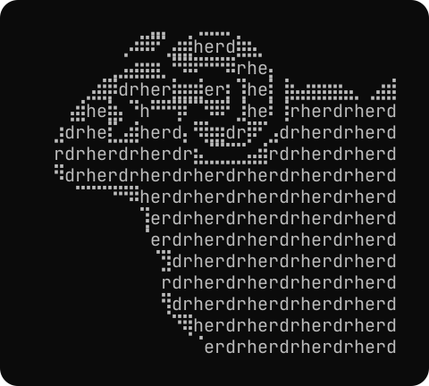

<p align="center">
  
</p>

<h1 align="center">Herdr Select</h1>

<p align="center">Your sessions. One small terminal picker.</p>

<p align="center">
  <a href="#how-it-works">How it works</a> ·
  <a href="#installation">Installation</a> ·
  <a href="docs/nix.md">Nix setup</a> ·
  <a href="LICENSE">MIT license</a>
</p>

A keyboard-driven session picker for [Herdr](https://github.com/herdrdev/herdr), built with Go and the Charm v2 libraries. Open a session, start a new one, or stop and delete an old one—all from a simple centered menu.

The selector runs in an interactive Linux terminal and hands that terminal to Herdr. After Herdr exits or detaches, the selector exits too. Detach from any existing Herdr pane before launching it.

<!-- Add the finished application's screenshot here once docs/screenshot.png exists:
<p align="center">
  
</p>
-->

## How it works

Herdr Select calls your installed `herdr` CLI. Herdr manages the actual sessions, processes, persistence, and restoration.

- **Pick up where you work.** Existing sessions sort from newest to oldest, with Running/Stopped status and compact ages such as `5min ago`.
- **Default at your fingertips.** The `default` session is highlighted on startup wherever it falls in the list.
- **Start something new.** New Session stays at the top. Enter a name, choose OK, and Herdr opens it.
- **See the actions that apply.** The centered footer changes with your selection: Open and Stop for a running session, Resume for a stopped one, and Delete where supported.
- **Confirm before stopping or deleting.** Deleting a running session stops it first, after confirmation. Herdr's default session cannot be deleted.

If Herdr cannot determine a session's state, its row shows **Unavailable** with a diagnostic; stop/delete stay disabled until a successful refresh. Failed refreshes keep the last list visible as stale.

The age comes from the modification time of each session's `session.json`. It indicates saved-state recency, not every keystroke or agent action. Missing timestamps display `—` and sort last. Ages stay fixed until the list is loaded again: press `r` to refresh, or complete a session operation that reloads the list.

## Keys

| Key | Action |
| --- | --- |
| ↑ / ↓ | Move through the list |
| Home | Jump to New Session |
| Enter | New, open, or resume the selected session |
| Shift+S | Stop a running session, with confirmation |
| Shift+D | Delete a named session, with confirmation |
| r | Refresh sessions and timestamps |
| Esc / q / Ctrl+C | Quit the picker |

In the New Session form, type a name and press Enter or choose **OK**. **Cancel** or Esc returns to the list. Tab moves between the input and enabled buttons. The footer is hidden while the form is open.

Session names are case-sensitive and accept **1–64 ASCII letters, digits, dots, underscores, and hyphens**. Whitespace is not allowed. `my-project`, `Project_2`, and `work.v2` are valid examples. Existing names, `default`, `.` and `..` cannot be used to create a new session. Names are rechecked before launch, but Herdr's use-or-create command cannot prevent another process creating that name at the same instant.

## Installation

Herdr must be installed separately and available on PATH. Herdr Select shows an installation warning if it cannot find it. It uses the same environment, configuration, and working directory as a direct Herdr invocation. Standard session commands list sessions on the current host; saved remote connections remain managed by Herdr.

From this checkout:

```sh
nix build
nix run
```

Once these commits are published, run or install from GitHub:

```sh
nix run github:pkieltyka/herdr-select
nix profile add github:pkieltyka/herdr-select
```

For declarative installation through NixOS or Home Manager, add this repository as a flake input and install its `herdr-select` package. See the [Nix setup guide](docs/nix.md) for the full configuration, prepared integration patch, and Ghostty shortcut. Applying the configuration, locking the published GitHub revision, and activating it are separate steps; the patch does not change your current desktop.

The flake exposes packages for `x86_64-linux` and `aarch64-linux`. It uses `pkgs.go` from its locked Nixpkgs input, with no custom Go source override.

## Development

```sh
nix develop
```

The shell includes Go, gopls, Git, Make, a C compiler for race tests, and nixfmt. Go is currently 1.27.3 from the committed Nixpkgs pin. Update the pin deliberately to adopt newer packaged toolchains:

```sh
nix flake update nixpkgs
```

Build and verify the current implementation:

```sh
go run ./cmd/herdr-select
go test ./...
go test -race ./...
go vet ./...
nix build
nix flake check
```

The design, architecture, and build phases live in [specs/projects/herdr-select](specs/projects/herdr-select/). Runtime artwork is plain terminal text; the README's [PNG](docs/logo.png) and [SVG](docs/logo.svg) are documentation assets.

## License

[MIT](LICENSE) © Peter Kieltyka.
