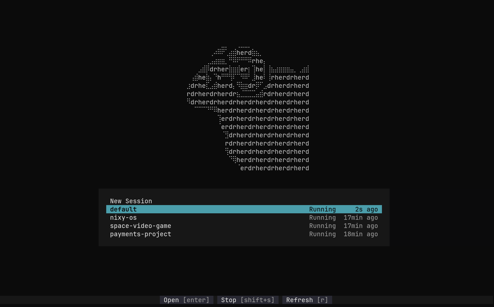

<p align="center">
  
</p>

<h1 align="center">Herdr Select</h1>

<p align="center">A tui selector for herdr sessions.</p>

<p align="center">
  <a href="#how-it-works">How it works</a> ·
  <a href="#installation">Installation</a> ·
  <a href="docs/nix.md">Nix setup</a> ·
  <a href="LICENSE">MIT license</a>
</p>

I like to group my [Herdr](https://github.com/herdrdev/herdr) tabs/agents by project and herdr sessions are the best way to do that.

`herdr-select` is a simple utility program written in Go which interacts with your local `herdr` cli to easily see all your
herdr sessions at once, create a new one or stop/delete them. 

Specifically, I use this with nixy-os as a hotkey with super+shift+return to launch herdr by first starting herdr-select
to show me which project setup I want to jump into (aka session), and go from there.


## How it works

Herdr Select calls your installed `herdr` CLI. Herdr manages the actual sessions, processes, persistence, and restoration.

- **Pick up where you work.** Existing sessions sort from newest to oldest, with Running/Stopped status and compact ages such as `5min ago`.
- **Default at your fingertips.** The `default` session is highlighted on startup wherever it falls in the list.
- **Start something new.** New Session stays at the top. Enter a name, choose OK, and Herdr opens it.
- **See the actions that apply.** The centered footer changes with your selection: Open and Stop for a running session, Resume for a stopped one, and Delete where supported.
- **Confirm before stopping or deleting.** Deleting a running session stops it first, after confirmation. Herdr's default session cannot be deleted.

If Herdr cannot determine a session's state, its row shows **Unavailable** with a diagnostic; stop/delete stay disabled until a successful refresh. Failed refreshes keep the last list visible as stale. Yellow action notices disappear after three seconds; red errors remain until resolved, dismissed, or replaced by a later action result.

The age comes from the modification time of each session's `session.json`. It indicates saved-state recency, not every keystroke or agent action. Missing timestamps display `—` and sort last. Ages stay fixed until the list is loaded again: press `r` to refresh, or complete a session operation that reloads the list.

## Keys

| Key | Action |
| --- | --- |
| ↑ / ↓ | Move through the list |
| Enter | New, open, or resume the selected session |
| Shift+S | Stop a running session, with confirmation |
| Shift+D | Delete a named session, with confirmation |
| r | Refresh sessions and timestamps |
| Esc / q / Ctrl+C | Quit the picker |

In the New Session form, type a name and press Enter or choose **OK**. **Cancel** or Esc returns to the list. Tab moves between the input and enabled buttons. The footer is hidden while the form is open.

Session names are case-sensitive and accept **1–64 ASCII letters, digits, dots, underscores, and hyphens**. Whitespace is not allowed. `my-project`, `Project_2`, and `work.v2` are valid examples. Existing names, `default`, `.` and `..` cannot be used to create a new session. Names are rechecked before launch, but Herdr's use-or-create command cannot prevent another process creating that name at the same instant.

## Installation

Install [Herdr](https://github.com/herdrdev/herdr#install) separately and make sure `herdr` is available on your `PATH`. Herdr Select shows an installation warning if it cannot find it. It uses the same environment, configuration, and working directory as a direct Herdr invocation. Standard session commands list sessions on the current host; saved remote connections remain managed by Herdr.

The supported targets are Linux x86-64 (`amd64`) and ARM64 (`arm64`); macOS and Windows have not been validated. Running the picker requires an interactive terminal.

### With Go (no Nix required)

Use [Go 1.27.3 or newer](https://go.dev/dl/), as required by [go.mod](go.mod):

```sh
go install github.com/pkieltyka/herdr-select/cmd/herdr-select@latest
```

Go installs the executable in `GOBIN` if configured, otherwise in the `bin` directory under `GOPATH` (normally `$HOME/go/bin`). Add that directory to your `PATH`. For the default location in Bash or Zsh:

```sh
export PATH="$HOME/go/bin:$PATH"
herdr-select --version
herdr-select
```

Add the `export` line to `~/.bashrc` or `~/.zshrc` to keep it for new terminals. If you use a custom Go installation directory, check `go env GOBIN GOPATH` and use its binary directory instead. Older Go installations with [automatic toolchain switching](https://go.dev/doc/toolchain) enabled may download the required toolchain; if yours refuses the required version, upgrade Go.

Run the same `go install` command again to update. With no published version tags, `@latest` installs the default branch; once release tags are published, it selects the latest release. Go installs currently print `dev+unknown` for `--version`; this does not mean installation failed.

### From source with Go

With Git and Go installed:

```sh
git clone https://github.com/pkieltyka/herdr-select.git
cd herdr-select
go build -o ./bin/herdr-select ./cmd/herdr-select
./bin/herdr-select --version
./bin/herdr-select
```

To install the checkout into your Go binary directory instead, run `go install ./cmd/herdr-select` and use the `PATH` setup above.

### With Nix

From this checkout:

```sh
nix build
nix run
nix run . -- --version
```

Run or install from GitHub:

```sh
nix run github:pkieltyka/herdr-select
nix profile add github:pkieltyka/herdr-select
```

For declarative installation through NixOS or Home Manager, add this repository as a flake input and install its `herdr-select` package. See the [Nix setup guide](docs/nix.md) for the full configuration, prepared integration patch, and Ghostty shortcut. Applying the configuration, locking the published GitHub revision, and activating it are separate steps; the patch does not change your current desktop.

The flake exposes packages for `x86_64-linux` and `aarch64-linux`. It uses `pkgs.go` from its locked Nixpkgs input, with no custom Go source override.

### Build version

`herdr-select --version` prints the build identity without requiring a terminal or Herdr. Nix builds use the tracked `VERSION` and the first six Git commit characters, for example `v0.1.0+abcdef`. Dirty Git builds append `.dirty`; sources without Git metadata use `v0.1.0+unknown`. Direct `go install` / `go build` / `go run` builds report `dev+unknown` unless a version is supplied with `-ldflags '-X main.version=...'`.

## Development

```sh
nix develop
```

The shell includes Go, gopls, Git, Make, a C compiler for race tests, and nixfmt. Go is currently 1.27.3 from the committed Nixpkgs pin. Update the pin deliberately to adopt newer packaged toolchains:

```sh
nix flake update nixpkgs
```

Build and verify the current implementation:

```sh
go run ./cmd/herdr-select
go test ./...
go test -race ./...
go vet ./...
nix build
nix flake check
```

The design, architecture, and build phases live in [specs/projects/herdr-select](specs/projects/herdr-select/). Runtime artwork is plain terminal text; the README's [PNG](docs/logo.png) and [SVG](docs/logo.svg) are documentation assets.

## License

[MIT](LICENSE) © Peter Kieltyka.
