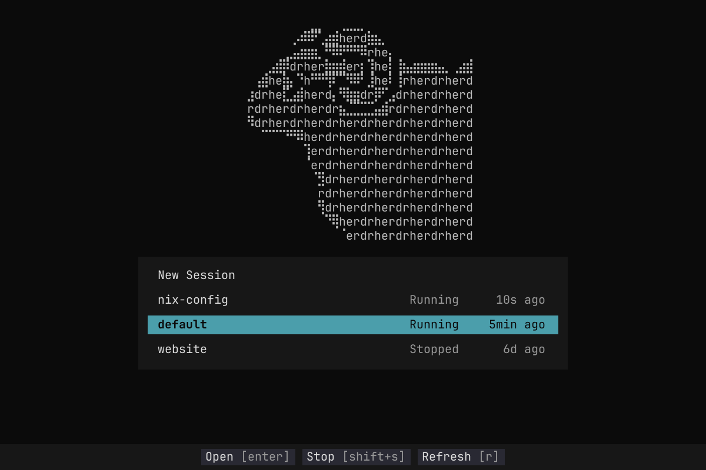
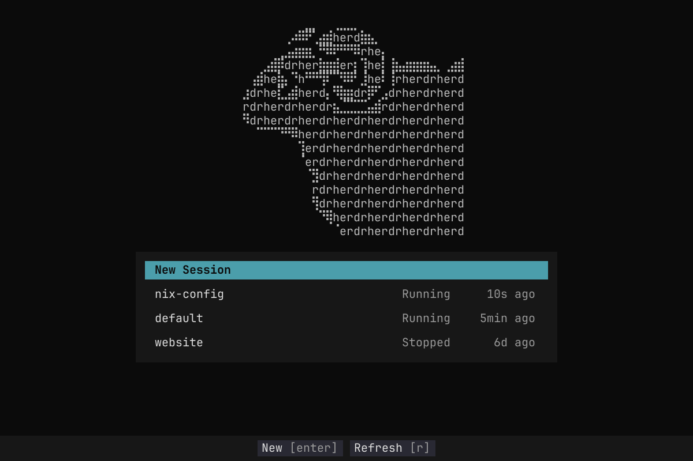
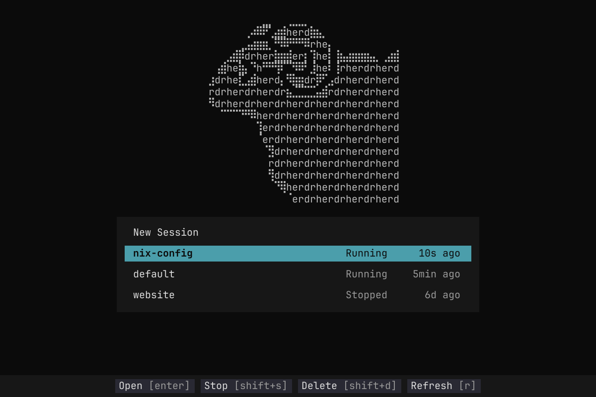
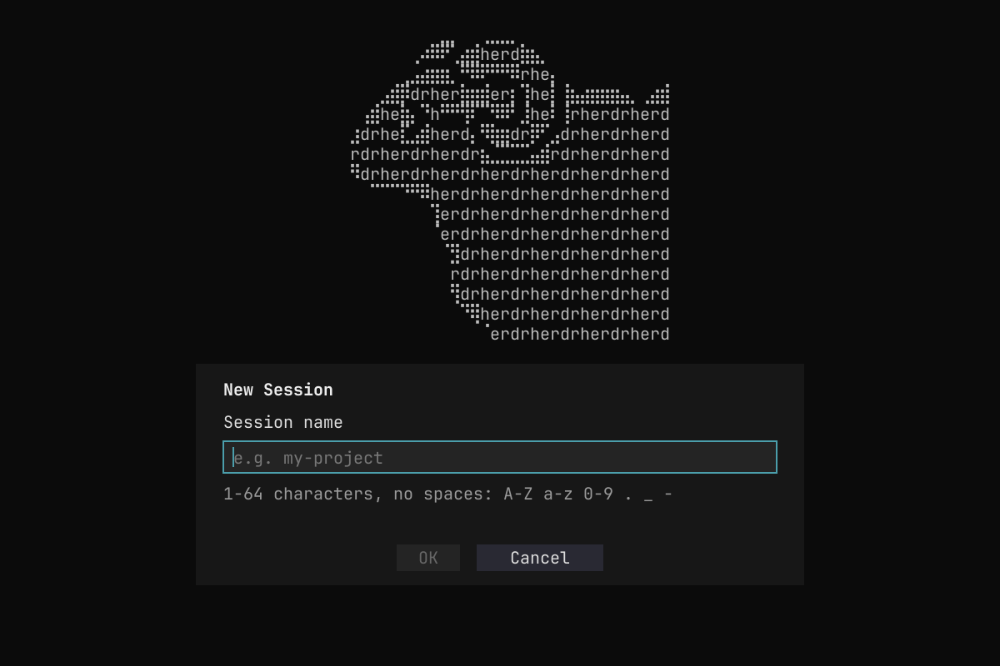
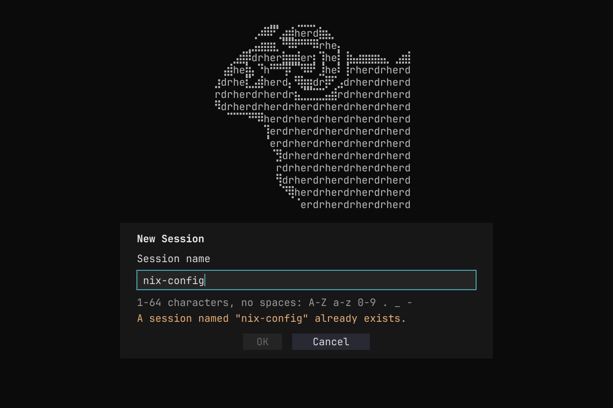
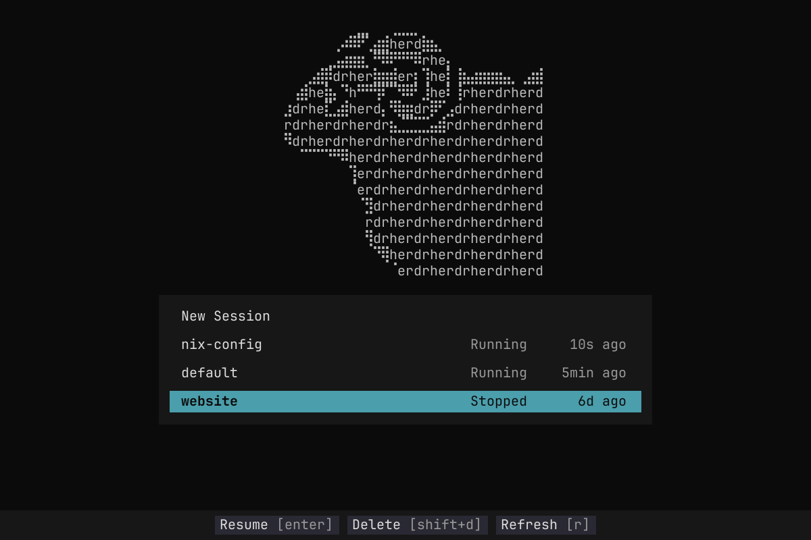

# UI Design: Herdr Select

## Visual direction

Render the supplied [Herdr ram logo](assets/reference-herdr-ram.png) as terminal character art above the centered menu. Use the [OpenCode menu reference](assets/reference-opencode-menu.png) for the padded charcoal panel and contrasting selection bar. Use the [Git TUI footer reference](assets/reference-action-footer.png) for a contextual action bar at the very bottom of the terminal.

The ram replaces the earlier block-letter wordmark. The original OpenCode wordmark reference and old `wordmark.txt` are retained as earlier design assets, not the current implementation target.

## Preview states

These are design mockups, not screenshots of an implementation. Session names and ages are illustrative.

**Initial selection:**



**New Session selected:**



**Running session selected:**



**New Session form:**



**Duplicate-name error:**



**Stopped session selected:**



The corresponding SVG files are editable preview sources. [ram-logo.txt](assets/ram-logo.txt) contains the proposed runtime character art. The preview uses one terminal text size for both logo characters and menu text; the runtime cannot independently resize terminal fonts.

## Layout and styling

- Reserve the terminal's bottom row(s) for the action footer. Center the logo and menu together in the remaining area, with approximately two blank terminal rows between them.
- Render the ram silhouette using repeated `herdr` letters for filled areas and Unicode braille characters for the outline and internal details. Preserve the horn and terminal-prompt cutout as far as character resolution permits. Use the provided 34-column, 16-row art as the starting point. Render text directly; no image protocol or runtime image-conversion dependency is needed.
- Use light gray (`#bcbcbc`) for the ram. Use compact plain `herdr` only for the locale/glyph fallback, with normal letter spacing and no extra gaps; terminal size does not trigger this fallback.
- Use a near-black full-screen background (`#0b0b0b`) and a charcoal menu panel (`#171717`) with no visible outline. Target about 76 columns on a spacious terminal; shrink to fit with outer margins. Provide roughly three cells of horizontal content padding and one cell around the highlight bar.
- Use light row text (`#dddddd`) and muted metadata (`#999999`). The selection bar is teal/cyan (`#4b9eab`) with near-black text (`#0b0b0b`), including the selected row's status and age, and a bold session label. These colors are proposed design values inspired by the references.
- Keep the logo grayscale so selection remains the main colored element. Adapt to limited-color terminals with a clearly distinguishable selected row.
- The tmux bar and window decoration in the references are outside the application UI.

## Main picker

Start the panel directly with **New Session**. On startup, select `default` at its recency-sorted position and scroll it into view; select New Session only if default is absent. Home jumps to New Session. Up/Down still move one row, so Up reaches New Session immediately only when default is the first existing session. Show no Select session heading, Esc hint, up/down hint, search field, or column headings. New Session has no status or age. Keyboard navigation, Esc, q, and Ctrl+C retain the behavior specified in the functional spec.

Existing rows show the name at left, Running/Stopped in a trailing status column, and a compact age at the far right: `10s ago`, `5min ago`, `1h ago`, or `6d ago`. Sort by `session.json` modification time, newest first, including default. Unknown ages show `—` and sort last. Capture ages on successful session-list loads and keep them fixed between loads; `r` refreshes ages, status, and timestamps while preserving selection. Successful reloads around session operations also renew the snapshot; failed reloads retain it. No autonomous age ticking (approved UI feedback superseding the original design).

Fit panel height to its contents and the available terminal area. Long lists scroll inside the panel with a subtle position/count indicator. New Session remains the first list item but may scroll out of view when navigating a long list. Keep the action footer outside the scrolling region.

## Contextual action footer

Anchor a full-width charcoal strip to the bottom of the terminal. Center the action badges as a group across the full terminal width, with readable foreground labels, muted bracketed shortcuts, and a slightly lighter background (`#292933`) for each badge. This uses the reference's action-first format rather than a sentence of navigation instructions.

| Selected row | Footer actions |
| --- | --- |
| New Session | `New [enter]` · `Refresh [r]` |
| Running session | `Open [enter]` · `Stop [shift+s]` · `Delete [shift+d]` · `Refresh [r]` |
| Stopped session | `Resume [enter]` · `Delete [shift+d]` · `Refresh [r]` |

Change the footer immediately as keyboard selection changes. A stopped session has no Stop action; Enter is its Resume action. New Session exposes no stop/delete actions. The default session omits Delete in either state because Herdr cannot delete it; it retains Open/Stop when running and Resume when stopped. Esc and arrow navigation remain implicit. Mouse hover is not required to select rows in v1.

## New Session input

Replace the list with a **New Session** heading, **Session name** label, and an initially empty, focused single-line input. Preserve the ram, panel background, and width. Show `e.g. my-project` as a muted placeholder and use a cyan focus outline around a slightly lighter charcoal input surface.

Below the field, show the hint `1-64 characters, no spaces: A-Z a-z 0-9 . _ -`. Spaces, tabs, and all other whitespace are invalid, including at the start or end. Place a subtle gray (`#444444`) horizontal divider immediately below the New Session title, across the form interior. Reserve one or two inline diagnostic rows as terminal height permits so validation does not shift the buttons. Remove the additional blank spacer before the buttons; longer messages scroll within the reserved area. Show **OK** and **Cancel** side by side, centered below the field. OK is disabled and muted while empty, invalid, or known to duplicate a session; Cancel remains enabled. Input has focus on entry, not either button. Tab/Shift+Tab cycles the input and enabled buttons; Enter in the input submits and Enter on a button activates it. Esc cancels from anywhere in the form.

Hide the entire bottom footer while the New Session form is open, including validation-error and submission states. The in-panel OK and Cancel buttons provide the actions; Enter and Esc retain their behavior. Keep the logo and form placement steady, leaving the former footer area as the normal background. Show validation/checking progress inside the form. Restore the contextual footer when returning to the picker.

Validate as specified in the functional spec. Use concise inline messages, for example “Spaces are not allowed.”, “Use only letters, numbers, dots, underscores, and hyphens.”, “Use at most 64 characters.”, or “A session named ‘nix-config’ already exists.” Preserve the name and cursor while editing. After successful local validation, a submission refreshes the session list before creation; failure returns focus to the input. Cancel returns to New Session in the picker.

## Confirmations

Replace the panel contents with **Stop session**, **Delete session**, or **Stop and delete session**. Show the full session name and the consequences specified in the functional spec. Wrap long names without truncating their identity. Show **Cancel** and the explicitly named action beneath the message; select Cancel initially. Use the normal selection style and a restrained amber warning accent.

The bottom footer shows `Confirm [enter]` while the confirmation choices have focus. Left/Right or Tab changes the focused choice; Esc cancels. No Stop/Delete/Resume footer shortcut remains active behind the confirmation.

## Loading, errors, and results

- Show Loading sessions, Stopping, or Deleting in the same visual frame. While a picker action runs, show its busy state in the footer and disable repeated submissions. New Session submission instead shows progress in its panel and keeps the footer hidden.
- Missing-Herdr and nested-launch warnings use a clear message in the panel and `Quit [q]` in the footer.
- Discovery failure shows the error and Retry/Quit actions. Recoverable action failures and success messages appear below the list inside the panel, without obscuring selection. Wrap or scroll long diagnostics.
- Completed-action notices and non-error warnings use amber (`#d7af5f`) and disappear after approximately three seconds. Errors use red (`#e06c75`) and persist until resolved, dismissed, or superseded, including form validation, unavailable sessions, partial completion, and stale/uncertain operation failures. A notice expiry must never clear newer content. The timer continues through resizing and busy states without restarting on redraw, independently of the static relative ages. Confirmation headings and consequences remain until the confirmation is resolved.
- Replace panel contents between states rather than stacking dimmed copies of the picker behind modal layers.

## Small terminals

The fixed minimum is **80 columns × 36 rows**, across all views. Below either dimension, replace the entire UI (including logo, panel, and footer) with this centered block on the normal near-black background; style the title bold cyan and the dimensions/instruction in light text:

```text
Terminal too small

Current: 68 × 28
Minimum: 80 × 36

Resize to continue
```

Always use the actual current dimensions. Remove blank rows and shorten the message as needed; clip gracefully down to a single cell, and render nothing at zero width or height. Esc or Ctrl+C exits when idle. Ignore all other input, including paste, to prevent hidden edits or actions; pending-operation protection remains in effect and asynchronous results/notice expiry continue to process.

Enlarging restores the active view automatically, with selection, input/cursor/focus, confirmation, and scroll state retained where possible. At 80 × 36 or larger, retain the full ram and scroll long lists or diagnostics inside the panel. The locale fallback remains available. Keep the footer full-width and contextual, hidden in the form. This approved fixed minimum replaces the earlier adaptive compact-logo layout.

## Review state

The user approved the UI and functionality, including the ram character art, contextual centered footer, default-session initial selection, recency sorting, and validated New Session form with its footer hidden. This design and the functional spec are complete inputs to architecture.
